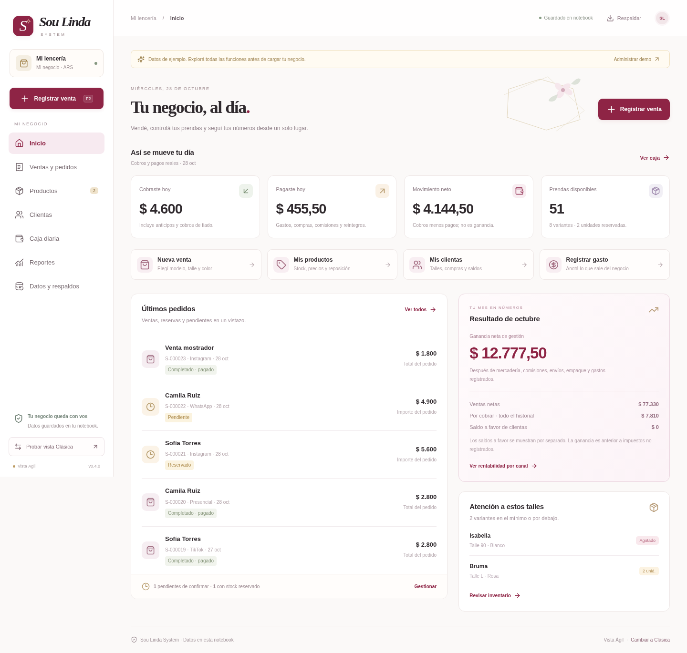
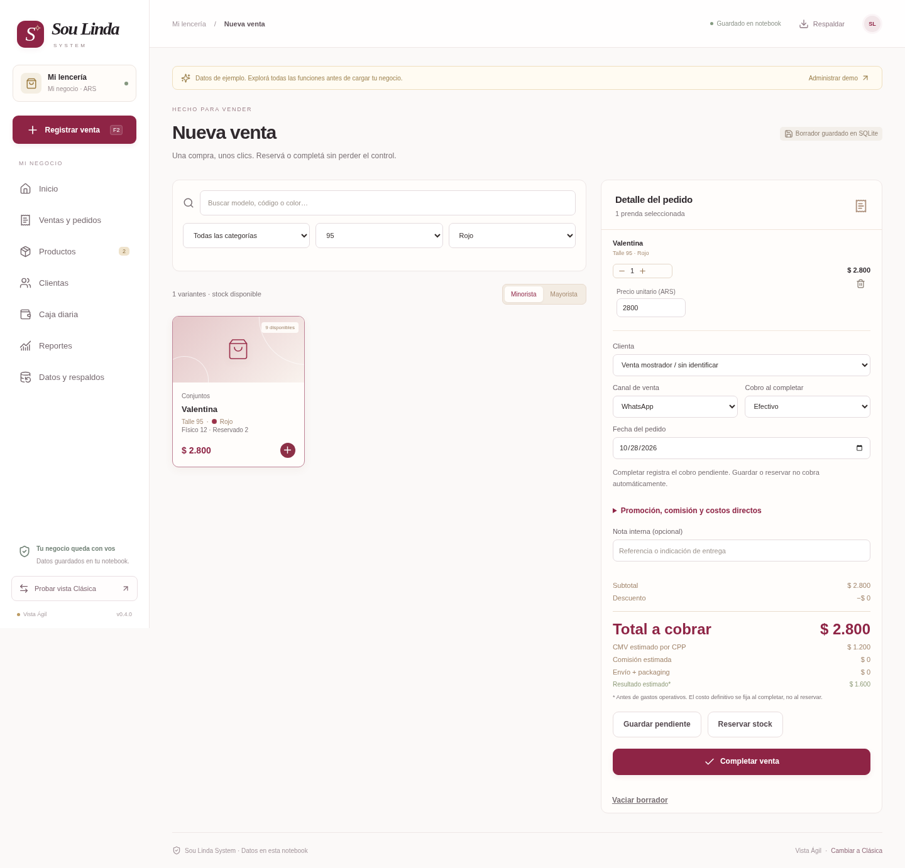

# Sou Linda System

Aplicación web local para gestionar una lencería. **Clásica** y **Ágil** usan la misma base de la notebook e incluyen inventario por talle/color, ventas, reservas, clientas, caja, rentabilidad CPP y respaldos.

## Descargar

**[Descargar Sou Linda System con las dos vistas](descargas/Sou-Linda-System-Dos-Vistas.zip?raw=true)**

[Descargar la versión original conservada](descargas/Sou-Linda-System-Web.zip?raw=true)

Si GitHub muestra la página del archivo, presioná **Download raw file** o el icono de descarga. El paquete ya contiene la interfaz compilada; no necesitás Node.js para usarlo.

## Abrir en Windows

1. Instalá [Python 3.12 o posterior](https://www.python.org/downloads/windows/) si todavía no lo tenés.
2. Extraé todo el ZIP en una carpeta.
3. Abrí **Abrir-Sou-Linda-Agil.cmd** para Ágil o **Iniciar-Sou-Linda-System.cmd** para Clásica.
4. La primera ejecución descarga las dependencias. Después mantené abierta la ventana del motor mientras trabajás.

Los dos accesos usan una sola base local. Si el motor está abierto, cambiá de vista dentro de la aplicación. Los reportes del celular necesitan la misma Wi-Fi y la notebook encendida.

## Vista Ágil

Las capturas contienen datos ficticios de demostración. La paleta se inspira en la imagen de redes de Sou Linda: bordó, rosa suave, marfil, dorado y verde salvia.

### Punto de venta

[Ver caja diaria](capturas/caja-agil.png) · [Ver reporte de celular](capturas/reportes-celular.png)

## Guías

- [Instalación, uso y respaldos](docs/web-local.md)
- [Cómo elegir entre las dos vistas](docs/alternativa-agil.md)
- [Arquitectura y base de datos](docs/architecture-web.md)
- [Resultados de validación](docs/validacion.md)
- [Documentación técnica original](README-TECNICO.md)

La versión 0.4.0 pasó 155 pruebas Python, 11 del frontend y recorridos de navegador. Los accesos de Windows requieren una prueba en Windows real. La moneda actual es ARS y está pendiente de confirmación con la tienda.

Esta entrega guarda código, paquetes y capturas de ejemplo. Las bases del negocio y las credenciales del acceso móvil se generan únicamente en la notebook y no forman parte de esta descarga. La aplicación no está publicada en Sites.
