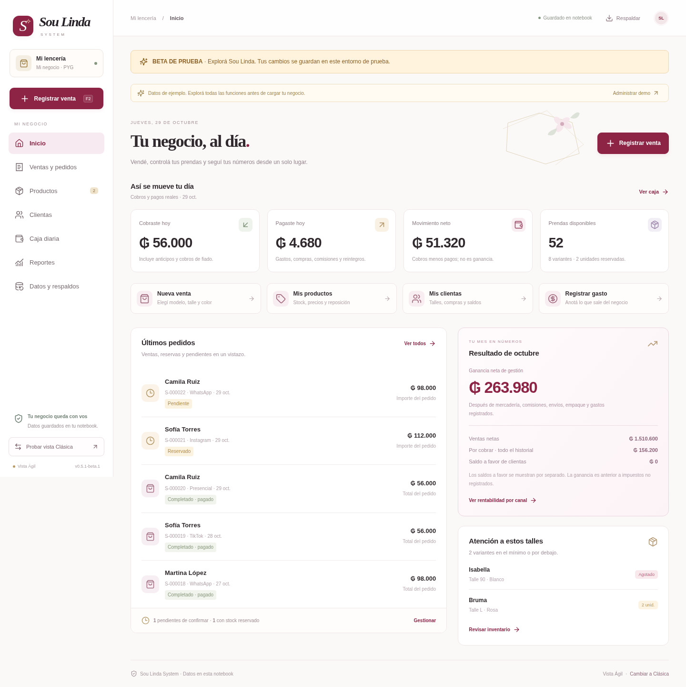
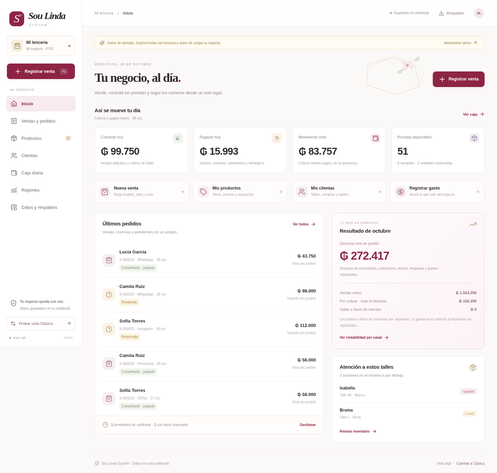
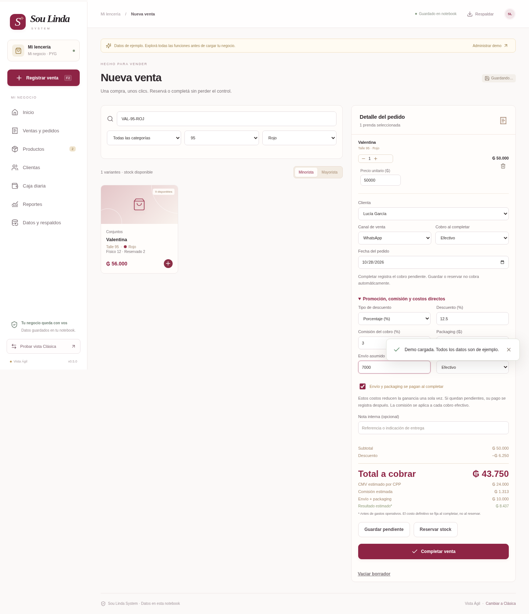

# Sou Linda System · Paraguay

Aplicación web local para una lencería paraguaya, en **guaraníes (PYG, ₲)**. Las vistas **Clásica** y **Ágil** comparten el inventario, las ventas y una sola base en la notebook.

## Probar la Beta 1

**[Descargar Sou Linda System · Beta 1](descargas/Sou-Linda-System-Beta-1.zip?raw=true)**

La beta 0.5.1-beta.1 inicia con productos, clientas y pedidos ficticios para probar ventas, talles/colores, reservas, caja y rentabilidad en guaraníes.

1. Instalá [Python 3.12 o posterior](https://www.python.org/downloads/windows/) si hace falta; activá su lanzador o **Add Python to PATH**.
2. Extraé todo el ZIP.
3. Abrí **Probar-Sou-Linda-Beta.cmd** y esperá la primera instalación de componentes. Mantené abierta la ventana del motor.

No necesitás Node.js. La beta guarda sus datos en `SouLindaSystemBeta`, separados de la edición normal, y conserva tus pruebas al reiniciar. Los ejemplos se cargan solo la primera vez. Para cerrar el motor, presioná Ctrl+C.

[Guía completa de la beta](LEEME-BETA.md) · [Validación técnica: 211 pruebas Python, 20 frontend y recorrido de navegador](docs/beta-1.md) · [SHA256 del ZIP](descargas/Sou-Linda-System-Beta-1.zip.sha256)

[Ver punto de venta de la beta](capturas/beta-pos.png) · [Ver reportes de la beta](capturas/beta-reportes.png)

El paquete se comprobó desde una extracción nueva en Linux. Los accesos `.cmd` están preparados para Windows y falta probarlos en el equipo real.

## Descargar la versión en guaraníes

**[Descargar Sou Linda System 0.5.0 · Guaraníes](descargas/Sou-Linda-System-Guaranies.zip?raw=true)**

El paquete incluye ambas vistas, la interfaz compilada, el motor Python y las guías. Los precios se muestran como **₲ 50.000**, sin decimales, en ventas, caja, recibos y reportes.

Si GitHub muestra la página del archivo, presioná **Download raw file** o el icono de descarga. No necesitás Node.js para usar el paquete.

## Abrir la edición 0.5.0 en Windows

1. Instalá [Python 3.12 o posterior](https://www.python.org/downloads/windows/) si todavía no lo tenés.
2. Extraé todo el ZIP en una carpeta.
3. Abrí **Abrir-Sou-Linda-Agil.cmd** o **Iniciar-Sou-Linda-System.cmd** para la vista Clásica.
4. La primera ejecución descarga dependencias. Mantené abierta la ventana del motor mientras trabajás.

Si el motor ya está abierto, cambiá de vista desde la aplicación. Los reportes del celular necesitan la misma Wi-Fi y la notebook encendida.

## Así se ve en guaraníes

Las imágenes muestran datos ficticios de demostración.

### Venta con descuento y comisión

[Ver caja diaria](capturas/caja-guaranies.png) · [Ver reporte del celular](capturas/reportes-guaranies.png) · [Ver Clásica](capturas/clasica-guaranies.png)

## Moneda y cálculos

Se ingresan guaraníes enteros. Los porcentajes admiten dos decimales; descuentos, comisiones y costos se redondean al guaraní manteniendo las conciliaciones. Por ejemplo, **₲ 50.000 − 12,5 % = ₲ 43.750**, con una comisión del 3 % de **₲ 1.313**.

Si restaurás una base anterior sin moneda o que conserva ARS, el sistema identifica su denominación original y muestra una advertencia. No aplica un tipo de cambio ni cambia el significado de datos reales automáticamente. Si solo cargaste una demo anterior, podés respaldarla y vaciarla desde Datos y respaldos para iniciar en PYG.

## Guías

- **[Guaraníes, redondeo, importación y bases anteriores](docs/guaranies.md)**
- [Instalación y respaldos](docs/web-local.md)
- [Elegir entre las dos vistas](docs/alternativa-agil.md)
- [Arquitectura y base de datos](docs/architecture-web.md)
- [Validación: 187 pruebas Python y 20 frontend](docs/validacion.md)
- [Documentación técnica](README-TECNICO.md)

Las pruebas de navegador verificaron la venta en PYG, caja, recibo, WhatsApp +595, restauración y reportes móviles. Los accesos Windows aún requieren una prueba en Windows real. No hay publicación en Sites ni facturación fiscal automática.

## Versiones anteriores conservadas

Estos paquetes anteriores están en ARS y se conservan como referencia; para la tienda paraguaya descargá la versión 0.5.0 de arriba.

- [0.4.0 · Dos vistas](descargas/Sou-Linda-System-Dos-Vistas.zip?raw=true)
- [0.3.0 · Original](descargas/Sou-Linda-System-Web.zip?raw=true)

Las bases reales del negocio y las credenciales móviles se crean solo en la notebook y no forman parte de los paquetes.
