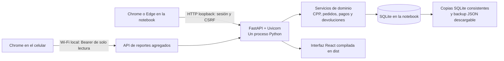
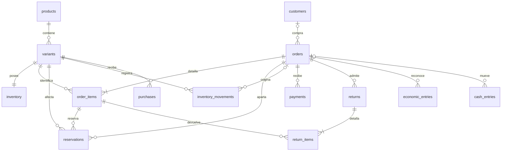

# Arquitectura vigente de Sou Linda System

Esta es la arquitectura de la edición web local. La notebook ejecuta Python y conserva una única base SQLite; Chrome o Edge muestran la interfaz. El celular consulta reportes mensuales agregados en la misma Wi-Fi mientras la notebook y el motor están encendidos.

El [SQL ejecutado por el motor](../server/src/sadi_local/schema.sql) es la fuente de verdad del esquema. Los documentos iniciales de IndexedDB y el directorio `desktop/` corresponden a etapas anteriores y no forman parte del arranque de esta edición.

La edición 0.5 usa PYG para negocios nuevos y conserva la identificación de las bases anteriores. La edición 0.4 agregó una [vista Ágil](alternativa-agil.md) en `/agil`, junto a la Clásica en `/`. Comparten API, sesiones, operaciones y base. Las capacidades públicas de Treinta se usaron como [referencia funcional](referencias-treinta.md); el diseño y la identidad son propios de Sou Linda System.

## Componentes y límites



| Capa | Implementación | Responsabilidad |
| --- | --- | --- |
| Arranque | [`server/run.py`](../server/run.py) y archivos `.cmd` | Ubicación de datos, bloqueo de instancia, copias automáticas, navegador y modo móvil |
| Interfaz | React, TypeScript, Vite y CSS local | POS, inventario, pedidos, clientas, finanzas y respaldo |
| Cliente HTTP | [`src/data/api.ts`](../src/data/api.ts) | Sesión local, CSRF, respuestas sin caché y errores de operaciones |
| API | [`web.py`](../server/src/sadi_local/web.py), `web_models.py`, `web_bridge.py` | Autorización, validación de entrada y adaptación a contratos de interfaz |
| Dominio | [`services.py`](../server/src/sadi_local/services.py), `money.py` | Reglas de stock, CPP, descuentos, cobros, devoluciones y operaciones idempotentes |
| Reportes | [`reports.py`](../server/src/sadi_local/reports.py) | Resultado mensual, canales, movimientos diarios y cierres de caja |
| Persistencia | [`db.py`](../server/src/sadi_local/db.py), `sqlite3` de Python | Transacciones, claves foráneas, snapshots coherentes y borradores |
| Intercambio | [`transfer.py`](../server/src/sadi_local/transfer.py), `web_transfer.py` | CSV, Excel, backup completo, validación y restauración |

La ejecución diaria no requiere Node.js, Qt, Electron ni un servidor externo de base de datos. Node.js se utiliza para desarrollar y compilar `dist/`; Python 3.12 o posterior ejecuta el paquete entregado. La primera instalación descarga las dependencias Python. Luego las operaciones normales funcionan sin Internet; WhatsApp depende de su servicio y conectividad.

La política de [guaraníes y compatibilidad](guaranies.md) distingue moneda, escala interna y redondeo. La moneda se conserva en `meta.currency` y se proyecta en los reportes, incluidos los del celular.

## Modelo relacional

Los identificadores de dominio son `TEXT`; los importes usan punto fijo `INTEGER` con escala técnica 100. En PYG se aceptan y reconocen guaraníes enteros (múltiplos de 100 en esa escala). Las tablas son SQLite `STRICT`. `PK` indica clave primaria, `FK` una relación declarada y `?` un campo que acepta `NULL`.



`expenses`, `cash_closings`, `drafts`, `meta` y `commands` también integran la base. Los campos `reference` de los libros guardan referencias de dominio que se validan en los servicios y el restaurador; no son claves foráneas polimórficas de SQLite.

### Catálogo, variantes e inventario

| Tabla | Campos | Restricciones y propósito |
| --- | --- | --- |
| `products` | `id PK`, `name`, `category`, `normalized_name` | Nombre normalizado único; un modelo agrupa sus variantes |
| `variants` | `id PK`, `product_id FK`, `sku`, `size`, `color`, `retail_cents`, `wholesale_cents`, `min_stock`, `active` | SKU único y combinación única `product_id + size + color`; precios no negativos |
| `inventory` | `variant_id PK/FK`, `on_hand`, `reserved`, `value_cents`, `version` | Una fila por variante; `0 ≤ reserved ≤ on_hand`; si no quedan unidades, el valor debe ser cero |
| `inventory_movements` | `id PK`, `sequence`, `variant_id FK`, `order_id FK?`, `quantity_delta`, `reserved_delta`, `value_delta_cents`, `kind`, `business_date`, `note`, `created_at` | Secuencia única y deltas de físico, reserva y valor; permite reconciliar el inventario |
| `purchases` | `id PK`, `business_date`, `variant_id FK`, `quantity`, `total_cost_cents`, `note`, `paid`, `method` | Entrada de mercadería y costo total real; el pago puede registrarse después sin duplicar el gasto |

El disponible se deriva como `on_hand − reserved`; no se mantiene otro contador independiente. La alerta compara disponible con `min_stock` para cada talle/color. El CPP se deriva de `value_cents / on_hand`; el costo unitario mostrado es informativo y no reemplaza el valor exacto del inventario.

### Clientas, pedidos, líneas y reservas

| Tabla | Campos | Restricciones y propósito |
| --- | --- | --- |
| `customers` | `id PK`, `name`, `phone`, `social`, `preferred_sizes` | Contacto y talles preferidos; el historial se obtiene desde pedidos |
| `orders` | `id PK`, `number`, `business_date`, `completed_date?`, `cancelled_date?`, `channel`, `customer_id FK?`, `status`, `terms`, `payment_method`, `subtotal_cents`, `discount_kind`, `discount_value`, `discount_cents`, `total_cents`, `cogs_cents?`, `commission_bps`, `shipping_cents`, `packaging_cents`, `direct_cost_method`, `direct_costs_paid`, `source`, `external_key?`, `created_at`, `version`, `notes` | Número único; `total = subtotal − descuento`; crédito requiere clienta; clave externa única para importaciones |
| `order_items` | `id PK`, `order_id FK`, `variant_id FK`, `model_snapshot`, `variant_snapshot`, `quantity`, `unit_price_cents`, `gross_cents`, `discount_cents`, `net_cents`, `cogs_cents?` | Una línea por variante en un pedido; conserva descripción, ingreso neto y costo histórico |
| `reservations` | `id PK`, `order_id FK`, `order_item_id FK`, `variant_id FK`, `quantity`, `state`, `expires_at?` | A lo sumo una reserva activa por línea; estados `active`, `consumed`, `released`, `expired` |

Los estados de pedido almacenados son `pending`, `reserved`, `completed` y `cancelled`. La capa web los presenta en español; su contrato heredado usa `void` para cancelado. `terms` distingue `immediate` de `credit`. Los canales permitidos son Instagram, WhatsApp, TikTok y Local. Los medios de cobro son Efectivo, Transferencia, Tarjeta, QR y Crédito; los egresos y pagos efectivos excluyen Crédito.

El esquema admite `expires_at` y el estado `expired`, pero esta entrega libera las reservas por acción explícita o cancelación: no ejecuta un planificador de vencimiento automático. Un pendiente no aparta stock; una reserva aparta disponible sin alterar el físico o el valor; completar consume físico y CPP dentro de la misma transacción. El costo de una reserva sigue siendo estimado hasta completarse.

### Cobros, devoluciones y gastos

| Tabla | Campos | Restricciones y propósito |
| --- | --- | --- |
| `payments` | `id PK`, `order_id FK`, `business_date`, `amount_cents`, `method`, `kind`, `commission_bps`, `commission_cents`, `created_at` | Importes positivos; `kind = receipt/refund` determina el signo; conserva comisión del cobro efectivo |
| `returns` | `id PK`, `order_id FK`, `business_date`, `revenue_cents`, `cogs_cents`, `created_at` | Cabecera de devolución física, distinta de un reembolso monetario |
| `return_items` | `id PK`, `return_id FK`, `order_item_id FK`, `quantity`, `revenue_cents`, `cogs_cents` | Una fila por línea y devolución; cantidades acumuladas limitadas a lo vendido |
| `expenses` | `id PK`, `business_date`, `category`, `cost_type`, `description`, `amount_cents`, `payment_method`, `channel?`, `paid` | Gasto fijo o variable; canal opcional para atribución; pago separado del reconocimiento |

El saldo del pedido conserva el signo:

```text
Saldo = cargo vigente − ingreso devuelto − (cobros − reembolsos)
```

Un saldo positivo está por cobrar; uno negativo representa crédito a favor de la clienta. Cancelar una reserva con anticipo libera stock y conserva la obligación de devolver el dinero. No crea un reembolso ficticio. Una venta completada solo puede cancelarse confirmando la devolución física de la mercadería restante. Las comisiones no se revierten automáticamente al devolver una compra.

### Libros financieros y soporte

| Tabla | Campos | Restricciones y propósito |
| --- | --- | --- |
| `economic_entries` | `id PK`, `business_date`, `bucket`, `amount_cents`, `order_id FK?`, `channel?`, `reference` | Ingresos, CMV, comisión, envío, packaging, gasto operativo y pérdida de inventario; admite compensaciones negativas |
| `cash_entries` | `id PK`, `sequence`, `business_date`, `method`, `delta_cents`, `kind`, `order_id FK?`, `reference`, `note` | Movimientos efectivos por medio de pago; secuencia única |
| `cash_closings` | `id PK`, `business_date`, `opening_cents`, `expected_cents`, `counted_cents`, `difference_cents`, `cutoff_sequence`, `note`, `created_at` | Foto del arqueo; diferencia igual a contado menos esperado; rectificar agrega un cierre |
| `drafts` | `key PK`, `payload`, `updated_at` | JSON del carrito y sus campos; clave `pos` para guardado automático |
| `meta` | `key PK`, `value` | Metadatos y marca de demostración |
| `commands` | `id PK`, `input_hash`, `result_json`, `created_at` | Resultado de comandos idempotentes y hash de su entrada |

Los libros económicos, de caja y de movimientos se agregan mediante los servicios; las correcciones financieras crean compensaciones y conservan el historial anterior. Esta regla se aplica en la API y los servicios, no mediante triggers de inmutabilidad contra quien edite directamente SQLite. Los cambios de estado y las proyecciones de inventario sí actualizan filas existentes. El backup incluye tanto libros como proyecciones para validarlos en conjunto.

## Motor financiero exacto

Los importes admiten hasta `9.000.000.000.000.000` unidades internas de escala 100 por campo validado. Python usa enteros y la interfaz valida que las respuestas sean enteros seguros; un importe de pantalla no se considera autoridad de cálculo. Los porcentajes se guardan en puntos básicos: `1000 bps = 10 %`, `300 bps = 3 %`.

### CPP y asignación de importes

```text
Valor tras una compra = valor anterior + costo total de la compra
Unidades tras la compra = unidades anteriores + unidades recibidas
CMV de la salida = redondeo(valor vigente × cantidad vendida / unidades físicas)
```

En PYG el redondeo es racional al guaraní más cercano, no una multiplicación acumulada de precios unitarios redondeados. La última salida consume el valor residual completo. Las reservas no cambian el denominador físico ni el valor. Cada línea completada fija su `cogs_cents`; las compras posteriores no reescriben ventas anteriores.

El descuento fijo o porcentual se calcula sobre el subtotal y se distribuye entre líneas por restos mayores, conservando el total en guaraníes. Reduce `net_cents`, sin alterar CPP ni CMV.

```text
Ganancia bruta = ingreso neto de descuento − CMV histórico
Resultado de venta = ingreso neto − CMV − comisiones efectivas − envío asumido − packaging
Resultado mensual = ingresos netos del período − CMV − comisiones − envío − packaging
                    − gastos operativos − pérdidas de inventario
```

Ejemplo verificado del motor: 10 unidades a ₲ 1.000 más 10 a ₲ 1.400 dan CPP de ₲ 1.200. Dos prendas a ₲ 2.000, con 10 % de descuento, comisión del 3 %, envío de ₲ 200 y empaque de ₲ 50, producen ingreso de ₲ 3.600, CMV de ₲ 2.400, comisión de ₲ 108 y resultado de venta de **₲ 842** antes de gastos operativos.

La comisión se reconoce en la fecha del cobro efectivo y sobre el importe cobrado. En un crédito sin cobrar, no se inventa una comisión pagada; la estimación del POS puede diferir hasta registrar los cobros. Envío y empaque se reconocen al completar y salen de caja únicamente cuando se registran pagados.

### Fechas, devoluciones y reportes

Los reportes suman `economic_entries` por `business_date`. Devolver hoy una venta de otro mes registra ingreso y CMV compensatorios hoy: no borra el resultado del mes original. Las devoluciones parciales asignan ingreso y costo mediante redondeo acumulado para recuperar exactamente el total al devolver la última unidad. La mercadería vuelve con su costo histórico. No se permite devolver inventario con costo ficticio si una importación no tiene CMV conocido.

El ticket promedio divide el total neto de las ventas nuevas completadas entre su cantidad. Las devoluciones se muestran en los ingresos del período y pueden producir días negativos, sin transformarse en ventas nuevas. Los saldos por cobrar, crédito a favor y anticipos son del historial completo y se rotulan de ese modo.

Por canal se muestran contribución después de costos directos y resultado después de gastos atribuibles. Los gastos compartidos quedan separados de forma predeterminada. Un prorrateo opcional los reparte por ingresos netos positivos de los canales, conserva signo y guaraníes y deja sin asignar el gasto cuando no existe una base positiva. No se declara un canal más rentable con costos incompletos.

Una venta histórica con `cogs_cents = NULL` mantiene el resultado real **incompleto**. La suma de costos conocidos puede mostrarse como dato parcial, pero la ganancia bruta/neta y el resultado del canal correspondiente son `NULL`, no cero. Antes de importar conviene completar el costo histórico en el archivo; esta entrega no sustituye ese dato por el costo actual.

El arqueo diario suma `cash_entries` por medio de pago. El efectivo esperado es el fondo inicial más los movimientos de efectivo. Cobrar fiado, pagar una compra y reembolsar una clienta afectan caja sin duplicar ventas ni gastos. Cada cierre conserva su secuencia de corte; movimientos posteriores se señalan y una rectificación añade otra foto, sin sobrescribir la anterior.

## Transacciones, concurrencia y guardado

- SQLite utiliza `foreign_keys=ON`, WAL, `synchronous=FULL` y `busy_timeout=5000`.
- Cada comando de dominio usa `BEGIN IMMEDIATE`; llamadas anidadas usan savepoints. Stock, reservas, pedido y libros se confirman juntos o se revierten juntos.
- La misma clave de comando con la misma entrada devuelve el resultado almacenado. Reutilizarla con otra entrada falla; los comandos que la usan evitan duplicados ante reintentos de respuesta perdida.
- Un bloqueo del sistema operativo impide dos motores sobre la misma carpeta. El servidor usa un proceso y una conexión SQLite creada y utilizada en el mismo hilo del ciclo de eventos.
- Las operaciones confirmadas se guardan por transacción. El borrador del POS se guarda con debounce; se distingue el borrador aún no guardado del confirmado y se protege su recuperación durante restauraciones.

El bloqueo no convierte al producto en una aplicación de edición multiusuario. Varias ventanas del navegador pueden mostrar datos, pero el carrito persistente pertenece a una única clave local `pos`; para operar conviene mantener una sola ventana de venta.

## Almacenamiento, backup e importación

En Windows se usa `%LOCALAPPDATA%\SouLindaSystem\sou-linda.sqlite3`. La instalación y `dist/` están separados de la base. `--data-dir` permite una carpeta explícita para pruebas o administración. `web-auth.json` guarda únicamente el hash del permiso móvil y no integra el backup del negocio.

El JSON completo incluye versión, checksum y las 19 tablas. Se valida en una base temporal: tipos, claves, referencias, cantidades, reservas, movimientos, libros, pagos y cierres. Solo después se reemplazan los registros dentro de una transacción de la base activa y se conserva una copia previa. El checksum detecta cambios del archivo; no cifra ni firma el contenido con una identidad de confianza.

Las copias SQLite y los snapshots se crean con `Connection.backup`, no copiando solo el archivo principal de una base WAL abierta. El arranque y cierre normal generan copias locales con retención de las últimas 20 copias automáticas; no se promete una copia de cierre ante corte eléctrico. Una copia en el mismo disco no protege de su pérdida: se debe descargar y conservar otro respaldo fuera de la notebook.

El importador admite CSV y `.xlsx`, con mapeo explícito, inspección y vista previa antes de aplicar. Limita el archivo a 10 MB y 20.000 filas, rechaza fórmulas de Excel y protege las celdas de texto exportadas frente a ejecución como fórmula. La cuenta de origen y el identificador externo permiten detectar ventas históricas duplicadas. Las ventas históricas no consumen el inventario físico actual. No se presupone una API ni un formato fijo de Treinta sin revisar la exportación real.

## Acceso local, móvil y PWA

El modo normal escucha en loopback. `--mobile` habilita la escucha de red y las direcciones privadas detectadas. La administración verifica el par ASGI real como loopback; no acepta `X-Forwarded-For` como permiso. Además exige cookie `HttpOnly`/`SameSite=Strict`, origen exacto y CSRF en mutaciones. Los hosts permitidos son explícitos. Las respuestas API llevan `Cache-Control: no-store`.

El celular recibe un token aleatorio de 256 bits mediante QR o enlace con fragmento. Se elimina el fragmento de la barra y se conserva el permiso en `sessionStorage` durante esa sesión; los reportes no se guardan en una base del teléfono. Solo se persiste el hash del token en la notebook. Rotarlo o revocarlo invalida el anterior.

`/api/mobile/reports` proyecta una lista permitida de campos mensuales agregados: ingresos, costos, gastos, rentabilidad, ventas diarias agregadas y canales. No devuelve nombres, teléfonos, líneas de pedidos, identificadores de ventas incompletas ni un backup. Los movimientos por medio de pago y el arqueo diario quedan en la administración de la notebook.

La conexión Wi-Fi usa HTTP y requiere una red de confianza. No hay TLS, publicación en Internet, sincronización en nube ni acceso externo configurado. En Windows solo debe permitirse la red privada necesaria; no se requiere desactivar el firewall ni abrir el router.

La PWA cachea exclusivamente archivos de interfaz. La operación sigue necesitando el motor Python, incluso sin Internet. Los service workers requieren un contexto seguro compatible; loopback tiene tratamiento especial, mientras una IP Wi-Fi sobre HTTP no garantiza instalación PWA. El celular consulta una página web normal, sin exigir esa instalación.

## Verificación y alcance

Las pruebas de `server/tests/` verifican dominio, dinero, stock, reportes, importación/restauración y autorización API con bases temporales. Las de `tests-web/` validan contratos y cálculos de entrada. El flujo de `tests-browser/` usa una base de demostración y verifica la interfaz real. Ejecutar código en Linux y revisar los `.cmd` no equivale a haber probado el equipo Windows de la usuaria: la prueba final de instalación y Wi-Fi debe hacerse allí.

Las [fuentes oficiales consultadas](../server/docs/platform-sources.md) documentan las decisiones de SQLite, middleware, autenticación y capacidades del navegador. La aplicación no incluye facturación fiscal, conciliación bancaria automática ni sincronización multiusuario. Esta entrega no publica un sitio en Sites ni crea un repositorio remoto: el proyecto queda preparado para ejecución y revisión local.
